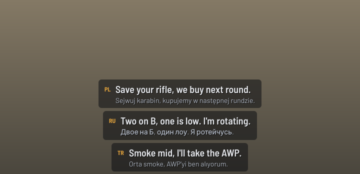
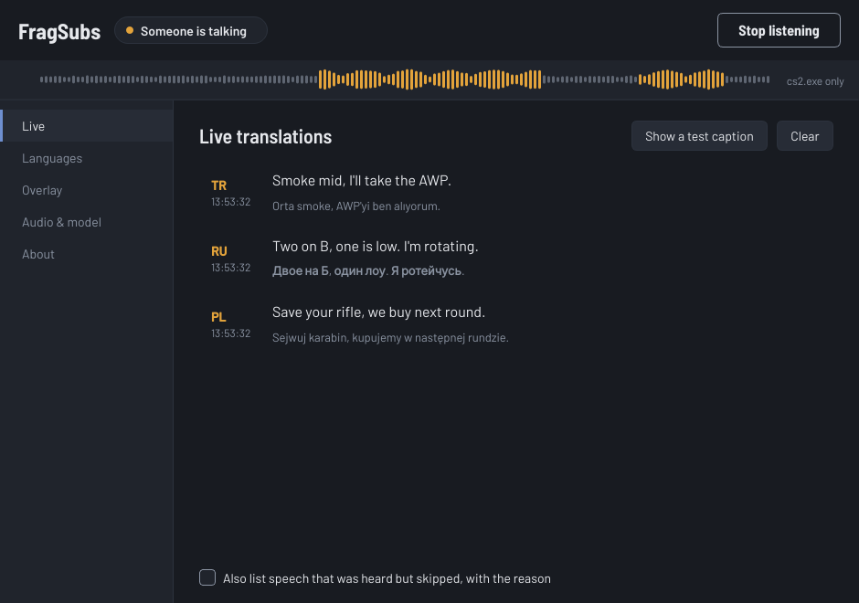

# FragSubs

Live English subtitles for your teammates' voice chat in Counter-Strike 2.
Website: **[fragsubs.com](https://fragsubs.com)**

FragSubs listens to the game's audio, works out which language each sentence
is in, and shows an English translation in a small overlay on top of the game.
Russian, Ukrainian, Polish, Turkish, German, French, Spanish, Portuguese,
Italian, Chinese, Japanese, Korean and Arabic are on by default; 32 languages
can be switched on. Everything runs on your own PC.





## Download

1. Download **[FragSubs-Setup.exe](https://github.com/flixerelixer/callout/releases/latest/download/FragSubs-Setup.exe)**
   (always the newest version) and run it. It installs for your user only, so
   no admin rights are needed, and adds Start menu and desktop shortcuts.
2. Windows may show a SmartScreen warning because the app is not code-signed.
   Click **More info**, then **Run anyway**.

You only install FragSubs once. Every time it starts, it checks this
repository for a newer release, downloads it, swaps its own files and
restarts. Your settings and downloaded models are kept. To update by hand
instead, turn off **About → Update automatically when FragSubs starts** and
use **Check for updates**. A portable zip is also attached to every
[release](https://github.com/flixerelixer/callout/releases).

FragSubs was called Callout before version 0.2.0. Existing copies update
themselves into FragSubs and move their data folder over automatically.

## First start

1. In Counter-Strike 2, set **Settings → Video → Display Mode** to
   **Fullscreen Windowed**. In plain Fullscreen the game hides every other
   window, including the overlay.
2. Click **Start listening**. The first time, FragSubs downloads what it needs:
   - **GPU support** (NVIDIA cards only, about 1.2 GB): NVIDIA's cuBLAS and
     cuDNN libraries, straight from NVIDIA's packages on PyPI.
   - **The speech model** (Whisper large-v3, about 3.1 GB) from Hugging Face.
3. Open **Overlay → Move overlay**, drag the box where you want captions, and
   press **Done**. Captions line up left, centre or right depending on where
   you put it.
4. Join a match. The signal meter at the top turns gold when FragSubs hears
   someone talking.

## Requirements

- Windows 10 (version 2004 or newer) or Windows 11
- Recommended: an NVIDIA GeForce RTX card with 4 GB of free VRAM. The large
  model uses about 3–4 GB and a few hundred milliseconds of GPU time per
  sentence, which games don't notice on modern cards.
- RTX 50-series cards need NVIDIA driver 570 or newer.
- Without an NVIDIA GPU, FragSubs runs on the CPU. Pick the **Small** model in
  **Audio & model** for real-time speed.

## How it works

```
cs2.exe audio ──► voice detector ──► Whisper ──────────────► overlay
 (game only)       (Silero VAD)      language ID +            + live log
                   cuts sentences,   translation to English
                   skips gunfire
```

- **Audio**: Windows' per-process loopback captures only `cs2.exe`, so music
  or YouTube in the background is not picked up. If the game is not running
  (or you choose *Everything I hear*), it captures your whole output device,
  which also covers Discord.
- **Voice detection**: Silero VAD cuts the stream into sentences and skips most
  gunshots, footsteps and other game sounds before they reach Whisper.
- **Translation**: [faster-whisper](https://github.com/SYSTRAN/faster-whisper)
  runs OpenAI's Whisper model. It identifies the language, then translates
  straight into English. The callouts of the map you're on are given to
  Whisper as context (see below), so map positions come out spelled right.
  Known Whisper hallucinations ("Thanks for watching", subtitle credits, an
  echo of the callout list) are filtered out.

## Map callouts

Whisper takes a short text prompt it treats as what was said just before, and
words in it come out spelled as written there. FragSubs fills it with the
callouts of the map you're playing ("Palace", "Banana", "Heaven" instead of
"pales", "bonanza", "heavy"), common Counter-Strike words (AWP, molly, eco,
one HP) and your own **Extra words**, such as teammates' names. The prompt is
limited to 223 tokens, which is why only the current map goes in.

Callouts for Ancient, Anubis, Cache, Dust 2, Inferno, Mirage, Nuke, Overpass
and Vertigo come from [totalcsgo.com/callouts](https://totalcsgo.com/callouts)
(`fragsubs/callouts.py`).

**Which map?** Under **Maps & callouts**, FragSubs detects the map through
Valve's Game State Integration (GSI): it writes
`gamestate_integration_fragsubs.cfg` into CS2's `game\csgo\cfg` folder, and the
game then posts the map name to `http://127.0.0.1:31975/` (data requested: the
map only). If CS2 was open when the file was first added, restart it once.
You can also pick the map by hand, which removes the file; uninstalling
FragSubs removes it too.

## Swearing and short shouts

Whisper learned from clean subtitles, so a one-second "нет, сука, блять" can
come out as "Mexico blyat". For short Russian and Ukrainian clips FragSubs
reads the Russian transcript first: if it is only swearing and short shouts
(сука, блять, нахуй, пиздец, давай, нет, ...), the English comes from a small
table in `fragsubs/slang.py` ("No, fucking hell!"). Russian swearing that
Whisper leaves in Latin letters ("Rush B, suka blyat") is translated, and an
"English" sentence with such words in it is tried again as Russian.

## Live captions

While a teammate is still talking, FragSubs translates what it has heard so
far every half second or so (one quick greedy pass) and shows it as a line
ending in "…" that grows as they speak. When they stop, the full pass (beam
search, the original words, all the checks) replaces that line. Previews only
run when the speech model has nothing else waiting, so they never hold up a
finished sentence; if a preview turns out to be noise, it is taken away again.
Switch it off under **Overlay → Show sentences while they're still being
spoken**. It needs an NVIDIA GPU.

## Reading the original words

Under each translation FragSubs can show what was actually said. Under
**Languages → Write the original words in** you choose their own alphabet
(Привет, 你好), Latin letters (Privet, nǐ hǎo) or both. Latin letters cover
Cyrillic, Chinese pinyin with tones, Korean, Arabic, Greek, Hebrew, Thai and
Hindi. Japanese kana become romaji; kanji stay as they are.

## Privacy and anti-cheat

- Audio never leaves your computer, and nothing you hear is saved to disk.
  The log file only contains technical messages. The only network traffic is
  the one-time downloads above and the update check against GitHub.
- FragSubs is a separate program. It reads the sound the game plays and
  never touches the game's memory or injects anything, so it is safe with
  VAC. The only file it adds to the game folder is the Game State Integration
  config above, Valve's official interface for overlays and RGB lighting.

## Limitations

- In-game voice chat is one mixed sound, so FragSubs can't tell which teammate
  said what.
- With an NVIDIA GPU the first words show up while someone is still talking
  and the line grows as they go; the careful final translation replaces it
  about half a second after they stop. On the CPU, captions only appear once
  the sentence is finished.
- Loud gunfights, bad microphones and heavy slang lower accuracy.

## Troubleshooting

| Problem | Try this |
| --- | --- |
| Overlay doesn't show in game | Use Fullscreen Windowed. Check **Show captions over the game** is ticked. |
| Meter moves, but no captions | Make sure the language is ticked under **Languages**. English is ignored unless you turn it on. |
| Meter doesn't move | Turn up voice chat volume in CS2. Or set **What to listen to** to *Everything I hear*. |
| "Could not load the speech model" on an NVIDIA GPU | Update your NVIDIA driver, or set **Run on** to CPU. |
| Something else | Logs are in `%LOCALAPPDATA%\FragSubs\logs`. Open an issue with the log attached. |

All settings, models and the GPU runtime live in `%LOCALAPPDATA%\FragSubs`.
Delete that folder to reset FragSubs completely.

## Run from source

Requires Python 3.12 on Windows.

```powershell
python -m venv .venv
.venv\Scripts\activate
pip install -r requirements.txt
python run.py
```

Run the tests with `pip install -r requirements-dev.txt` and `python -m pytest`.
Set `FRAGSUBS_DEBUG=1` to log every caption while testing.

## Building and releasing

GitHub Actions builds the Windows app on every push to `main` or a `ci/*`
branch (see the **Actions** tab for a downloadable build). To publish an
update, which every installed copy picks up on its next start, bump
`__version__` in `fragsubs/__init__.py` (for example to `0.2.1`) and push to
`main`.

When `main` has a version with no release yet, the workflow runs the tests,
builds `FragSubs.exe` with PyInstaller, checks it with `--self-test`, tests the
self-updater and the single-instance lock, builds `FragSubs-Setup.exe` with
Inno Setup (`installer/fragsubs.iss`), installs and uninstalls it, and
publishes release `v0.2.1` with:

- `FragSubs-Setup.exe`, the same file name in every release, so
  `releases/latest/download/FragSubs-Setup.exe` always works
- `FragSubs-v0.2.1-win64.zip`, which the self-updater downloads
- `Callout-v0.2.1-win64.zip`, for copies from before the rename

To build locally: `pip install -r requirements-dev.txt` and
`pyinstaller fragsubs.spec --noconfirm`. The app ends up in `dist\FragSubs`.

## Website

The site for [fragsubs.com](https://fragsubs.com) is in `site/` (plain HTML,
CSS and a little JavaScript). The **Website** workflow publishes it to GitHub
Pages whenever `site/` changes on `main`. One-time setup: in the repository
settings, under **Pages**, set the source to **GitHub Actions** and the custom
domain to `fragsubs.com`.

## Credits

- [Whisper](https://github.com/openai/whisper) by OpenAI, run with
  [faster-whisper](https://github.com/SYSTRAN/faster-whisper) and
  [CTranslate2](https://github.com/OpenNMT/CTranslate2)
- [Silero VAD](https://github.com/snakers4/silero-vad)
- [ProcTap](https://github.com/m96-chan/ProcTap) for per-process audio capture,
  [PyAudioWPatch](https://github.com/s0d3s/PyAudioWPatch) for output loopback
- [Barlow](https://github.com/jpt/barlow) typeface (SIL Open Font License)
- Built with [PySide6](https://doc.qt.io/qtforpython-6/)

Licensed under the MIT License.
